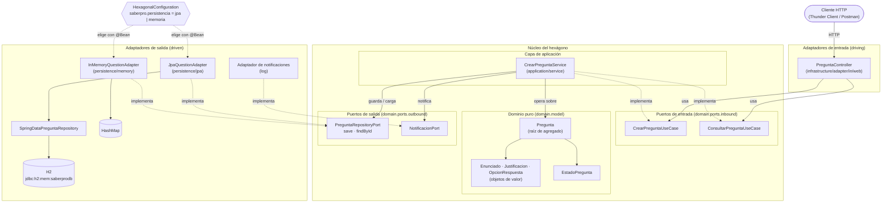
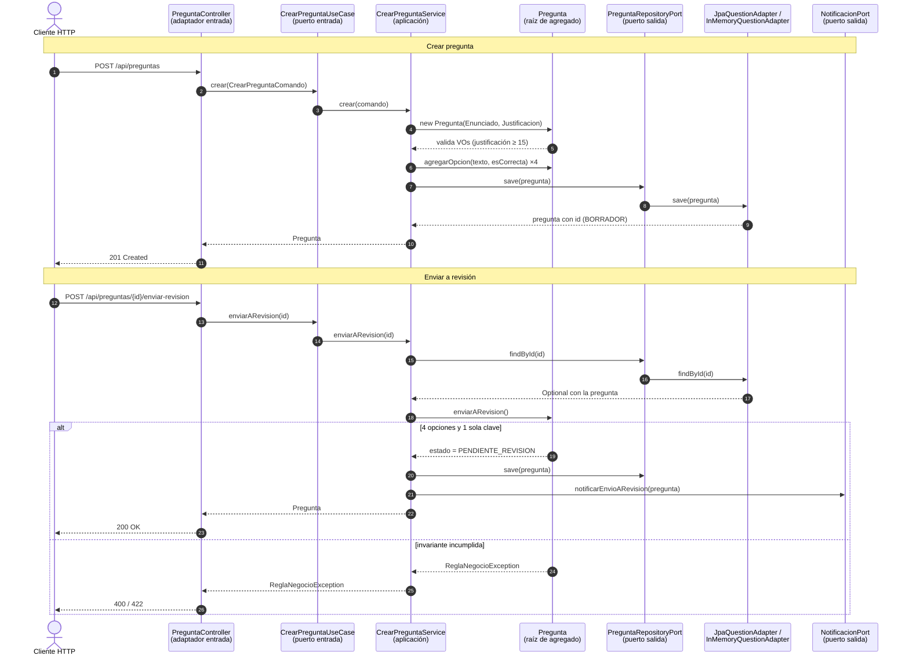
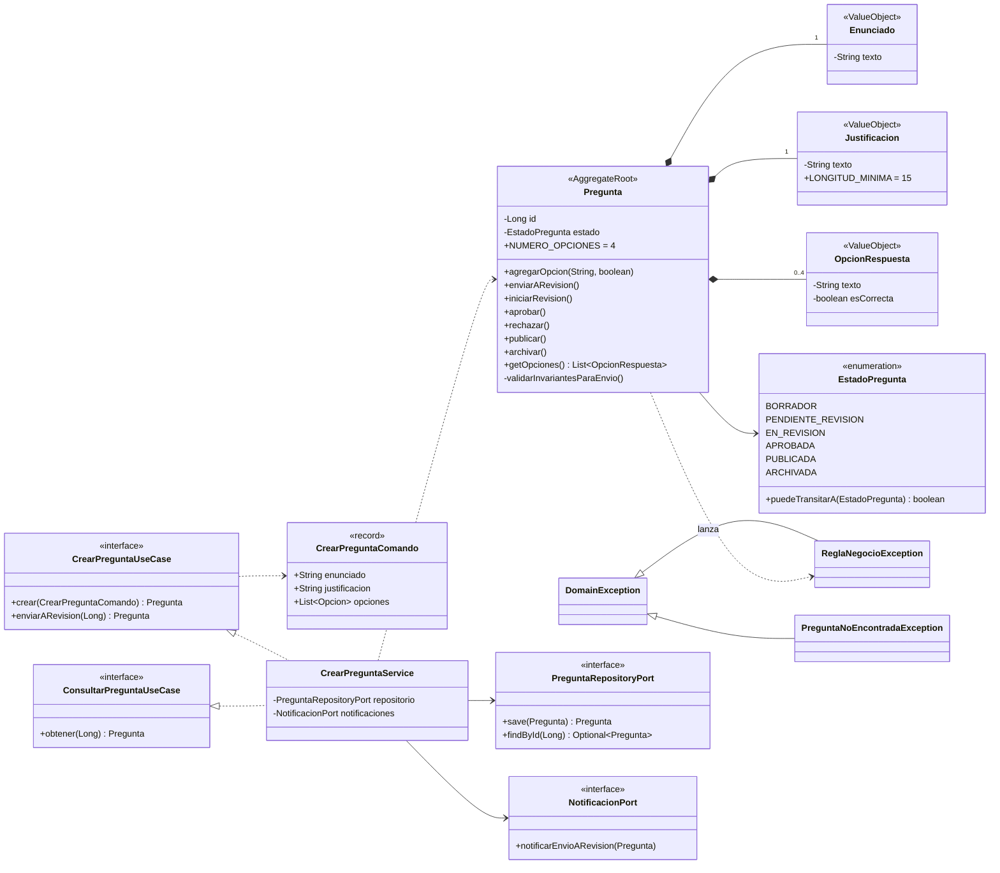

# lisw2_taller12_hexagonal

Taller 12 - Arquitectura Hexagonal y DDD (Fase I) del Banco de Preguntas Saber Pro.
Laboratorio de Ingeniería de Software II, Universidad del Cauca, 2026.2.

## Tecnologías

Java 17, Spring Boot 3.3, Spring Data JPA, H2 en memoria, Maven y JUnit 5.

## Estructura de paquetes

El dominio parte del modelo del taller 11 ([`lisw2_taller11_ddd`](https://github.com/MiguelMeza17/lisw2_taller11_ddd)).
Las dependencias apuntan siempre hacia `domain`, que es Java puro (sin Spring ni JPA).

```
co.edu.unicauca.saberpro
├── SaberProApplication.java          arranque de Spring Boot
├── domain/                           núcleo del hexágono (Java puro)
│   ├── model/                        Pregunta (raíz de agregado), Enunciado, Justificacion, OpcionRespuesta, EstadoPregunta
│   ├── exception/                    DomainException, ReglaNegocioException
│   └── ports/
│       ├── inbound/                  puertos de entrada (casos de uso)
│       └── outbound/                 puertos de salida (persistencia, notificaciones)
├── application/
│   └── service/                      implementación de los casos de uso
└── infrastructure/
    ├── adapter/in/web/               controlador REST
    ├── adapter/out/persistence/jpa/  JpaQuestionAdapter (H2)
    ├── adapter/out/persistence/memory/ InMemoryQuestionAdapter (HashMap)
    └── config/                       conexión de adaptadores con puertos
```

## Diagramas

Fuentes en `docs/diagramas/*.mmd` (Mermaid; GitHub los dibuja directamente).

### Puertos y adaptadores



### Secuencia: crear pregunta y enviarla a revisión



### Clases del dominio y puertos



## Informe técnico y evidencias

- Informe en la plantilla oficial: [`docs/lisw2_taller12_g1.docx`](docs/lisw2_taller12_g1.docx) (modelo hexagonal, modelo DDD, diagramas, evidencias de intercambiabilidad y resultado de las pruebas).
- Diagramas en PNG: [`docs/diagramas/`](docs/diagramas/) (generados desde los `.mmd`).
- Evidencias del experimento de intercambiabilidad: [`docs/evidencias/intercambiabilidad.md`](docs/evidencias/intercambiabilidad.md).

## Ejecutar

```bash
mvn test              # pruebas
mvn spring-boot:run   # API en http://localhost:8080, consola H2 en /h2-console (jdbc:h2:mem:saberprodb, usuario sa)
```

## Pruebas

`mvn test` ejecuta pruebas JUnit 5 en tres niveles:

| Nivel | Clases | Qué verifican |
|---|---|---|
| Dominio (Java puro, sin Spring) | `EnunciadoTest`, `JustificacionTest`, `OpcionRespuestaTest`, `PreguntaTest` | Value Objects inmutables (nulo/vacío, mínimo 15 caracteres, igualdad por valor); agregado `Pregunta` con 3 o 5 opciones, 0 o 2 claves, transición BORRADOR → PENDIENTE_REVISION y reconstitución |
| Aplicación | `CrearPreguntaServiceTest` | `CrearPreguntaService` con el adaptador real `InMemoryQuestionAdapter` y un `NotificacionPort` falso (`NotificacionPortFalso`) |
| Arquitectura | `DominioPuroTest` | `domain` y `application` no importan Spring, JPA ni `infrastructure` (misma regla que el workflow de CI) |
| Adaptadores | `JpaQuestionAdapterTest`, `InMemoryQuestionAdapterTest`, `HexagonalConfigurationTest` | Cada adaptador cumple el contrato del puerto y la configuración elige el adaptador según `saberpro.persistencia` |
| Integración (`@SpringBootTest` + MockMvc) | `PreguntaControllerTest`, `IntercambiabilidadTest` | El controlador REST con los **mismos asertos** ejecutados con el adaptador JPA y con el de memoria |

## Intercambiar el adaptador de persistencia

`infrastructure/config/HexagonalConfiguration` declara con `@Bean` qué adaptador implementa
`PreguntaRepositoryPort`, según la propiedad `saberpro.persistencia`:

| Valor | Adaptador | Almacenamiento |
|---|---|---|
| `jpa` (por defecto) | `JpaQuestionAdapter` | H2 en memoria vía Spring Data JPA |
| `memoria` | `InMemoryQuestionAdapter` | `HashMap` |

Se cambia en `application.properties` o al arrancar, sin tocar el paquete `domain`:

```bash
mvn spring-boot:run                                                   # JPA
mvn spring-boot:run -Dspring-boot.run.arguments=--saberpro.persistencia=memoria   # memoria
```
